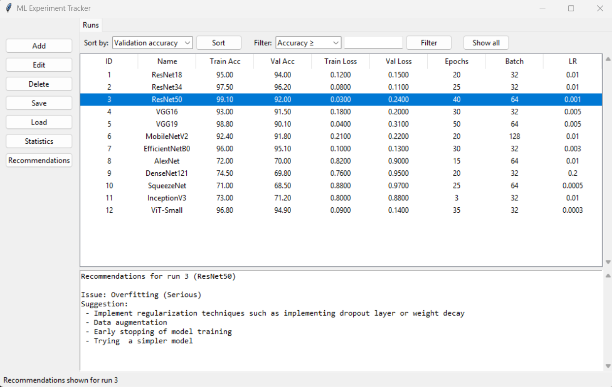

# ML Experiment Tracker


A Python application for recording, comparing and analysing machine learning experiment runs. It has two front ends that share the same core logic:

- **Text-based version** (command line): `tracker_cli.py`
- **GUI version** (Tkinter): `tracker_gui.py`

Developed for CSC-44102 Foundations of Programming and Software Engineering, Keele University.



## Features
- Add, update and delete runs (each run has a unique ID)
- Import and export runs as **CSV** or **JSON**
- Sort runs by validation accuracy (high to low) or validation loss (low to high), using a hand-written merge sort
- Filter runs by accuracy or loss threshold, or search by model name
- Statistics: mean, variance, standard deviation and best run
- Rule-based training suggestions (overfitting, underfitting, learning rate, epochs)
- Input validation with friendly error messages; invalid files never overwrite existing runs
- Prompt to save unsaved changes before quitting (both versions)

## Requirements
- Python 3.12 or later
- Standard library only, no extra installs (Tkinter is included with Python)

## How to run

### Command-line version
```
python tracker_cli.py
```
Choose options from the numbered menu.

### GUI version
```
python tracker_gui.py
```
- Use the buttons on the left to add, edit, delete, save and load runs.
- Select a row in the table before using **Edit**, **Delete** or **Recommendations**.
- Use the controls above the table to sort or filter; **Show all** resets the view.
- Statistics and recommendations appear in the panel below the table (drag the divider to resize it).

### Try it with sample data
Load `sample_data/sample_runs.csv` in either version to explore the features with 12 example runs.

### Run the tests
```
python -m unittest -v
```
Tests also run automatically on every push and pull request (GitHub Actions, Ubuntu and Windows).

## File format
CSV and JSON files use these fields:

| Field | Type | Rule |
|---|---|---|
| model_name | text | not empty |
| training_accuracy | number | 0–100 |
| training_loss | number | ≥ 0 |
| validation_accuracy | number | 0–100 |
| validation_loss | number | ≥ 0 |
| epochs | whole number | > 0 |
| batch_size | whole number | > 0 |
| learning_rate | decimal number | > 0 |

Example CSV:
```
model_name,training_accuracy,training_loss,validation_accuracy,validation_loss,epochs,batch_size,learning_rate
ResNet18,95.0,0.12,94.0,0.15,20,32,0.01
```

## Project structure
```
tracker_core.py           core logic (data, validation, storage, sorting, statistics, recommendations)
tracker_cli.py            command-line interface
tracker_gui.py            Tkinter graphical interface
test_tracker_core.py      unit tests
sample_data/              example runs for trying the app
.github/workflows/        CI configuration
```

## GenAI acknowledgement
This README and the sample data were produced with the help of Claude (Anthropic, https://claude.ai). The application code is my own work; Claude was used only to review drafts and give feedback, as permitted for Assessment 1.